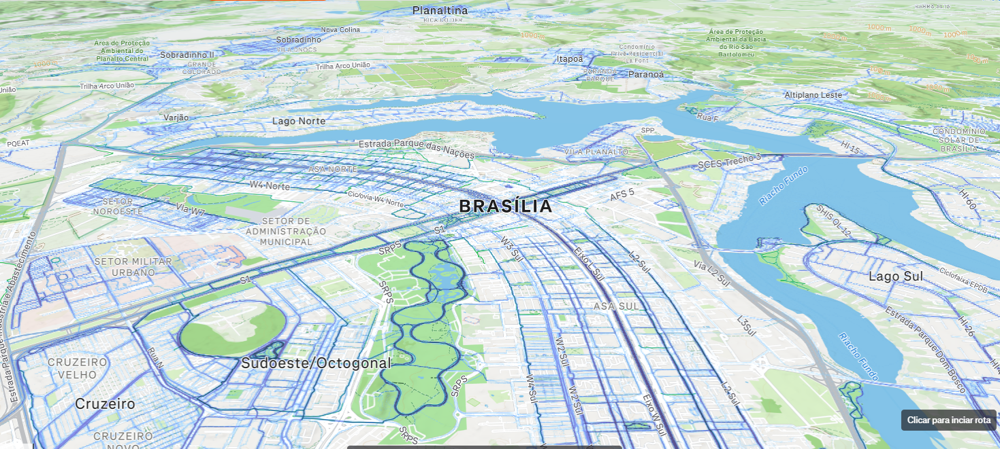

# Introduction {.unnumbered}

This is the material for the **Course on programming for data analysis with the R
software**, offered to the Undersecretariat for Development and Planning of Brazil's
**Ministry of Transport**.

The course is built around **case studies**: each topic reproduces, in R, tasks the team
already carries out day to day. Today these usually happen in spreadsheets, in point-and-click
GIS software or in a separate tool for each step. The aim is to show how to do the same
thing in a **single reproducible workflow** that can be run again when the data are
updated.

::: {.callout-tip appearance="simple"}
All the material on this site is public and permanent. Code can be copied with the button
in the top-right corner of each block, and the example data are listed in
[Example data](a-dados.qmd).
:::

::: {.callout-note appearance="simple"}
This is the English version of a course originally taught in Portuguese. The text is
translated; the R code keeps its **variable names in Portuguese**, and so do the data
(Brazilian public sources) and some labels inside figures.
:::

## General goal

To train the team in using R for spatial data analysis, geoprocessing, integration of
public datasets and production of georeferenced information, focusing on supporting
planning and decision-making in the transport infrastructure sector.

## Skills developed

- Handle vector and raster spatial data: reading, editing, transforming and analysing.
- Integrate georeferenced public datasets: IBGE (Census), SIDRA, GPS, OpenStreetMap, GTFS.
- Export results in the usual formats: `.shp`, `.gpkg`, `.xlsx`, `.csv` and matrices.
- Run applied spatial analyses: intersections, *buffers*, *overlays*, distances,
  neighbourhood and spatial statistics.
- Work with text, dates and `data.frame`s safely and reproducibly.
- Produce technical thematic maps: origin–destination, accessibility and model outputs.
- Automate geoprocessing routines: geocoding, routing and address standardisation.
- Produce reproducible reports with Quarto/R Markdown.

## Structure

The course has **30 hours**, split into 5 weekly modules of 6 hours: **3 synchronous hours**
(two 1h30 sessions) and **3 asynchronous hours** (recorded material and guided exercises),
for up to 30 participants, online.

| Module | Topic | Case study |
|:------:|:-----|:---------------|
| 1 | [R fundamentals and data wrangling](m1-00-visao-geral.qmd) | Coastal shipping TKU (ANTAQ) |
| 2 | [Spatial objects: vectors and rasters](m2-00-visao-geral.qmd) | Area of influence of the BR-116 highway |
| 3 | [Data integration, routing and OD matrices](m3-00-visao-geral.qmd) | Slope × alignment; coastal shipping flows on the map |
| 4 | [Remote sensing and accessibility](m4-00-visao-geral.qmd) | Accessibility in Fortaleza |
| 5 | [Thematic maps, reproducible reports and final project](m5-00-visao-geral.qmd) | Fortaleza accessibility report (final project) |

## Schedule

| Module | Synchronous class I | Synchronous class II | Asynchronous content |
|:-------|:----------------|:-----------------|:--------------------|
| 1. R fundamentals and data wrangling | 28/09 (Mon), 14:00–15:30 | 01/10 (Thu), 14:00–15:30 | 02/10 (Fri), from 14:00 |
| 2. Spatial objects: vectors and rasters | 05/10 (Mon), 14:00–15:30 | 06/10 (Tue), 14:00–15:30 | 07/10 (Wed), from 14:00 |
| 3. Data integration, routing and OD matrices | 13/10 (Tue), 14:00–15:30 | 14/10 (Wed), 9:30–11:00 | 16/10 (Fri), from 14:00 |
| 4. Remote sensing and accessibility | 19/10 (Mon), 14:00–15:30 | 21/10 (Wed), 9:30–11:00 | 22/10 (Thu), from 14:00 |
| 5. Advanced thematic maps, reproducible reports and final project | 26/10 (Mon), 14:00–15:30 | 27/10 (Tue), 14:00–15:30 | 23/10 (Fri), from 14:00 |

Dates are day/month, 2026, Brasília time.

## Opening session

The slides of the first session, with the course outline and the instructor's
introduction (in Portuguese): [download as PDF](../slides/00-abertura-curso.pdf) (1.7 MB).

<iframe src="../slides/00-abertura-curso.pdf" width="100%" height="480" style="border: 1px solid #ddd;" title="Slides of the opening session"></iframe>

## How to follow the course

1. **Before the module:** check the [Installation](m1-01-ambiente.qmd) page and make sure
   R, RStudio and the module's packages are working.
2. **Download the module data:** on the repository's
   [Releases](https://github.com/Joaobazzo/curso-r-transportes/releases) page, download the
   module's `dados_moduloN.zip` file and unzip it **inside the course project folder**. The
   files go to the `dados/` folder, where the chapters' code looks for them, and the class
   does not depend on an internet connection.
3. **During the synchronous session:** follow along by running the code. Every block can be
   run and uses public data or the course's example files. The exception is the four-step
   model extract, shared for teaching purposes (see [Example data](a-dados.qmd)).
4. **After the session:** read the asynchronous part of the module and do the exercises.
5. **Questions:** open an *issue* in the
   [course repository](https://github.com/Joaobazzo/curso-r-transportes/issues) or send an
   e-mail. Questions in *issues* stay on record and help the other participants.

## What you get

- This website, public and permanent, with every chapter and all the code.
- A GitHub repository with scripts, example datasets, [slides](https://github.com/Joaobazzo/curso-r-transportes/tree/main/slides) and the final project.
- A digital certificate at the end of the course.

## Instructor

**João Pedro Bazzo Vieira** is a PhD candidate in transportation engineering at the University of Toronto, working on urban accessibility, emissions and transport network modelling, and
co-author of R packages in the `ipeaGIT` ecosystem (`gtfs2gps`, `gtfs2emis`, among others). Website: <https://joaobazzo.netlify.app/>.

## Licence

The text and figures of this material are under
[CC BY-SA 4.0](https://creativecommons.org/licenses/by-sa/4.0/): they may be copied,
adapted and redistributed, with credit and under the same licence. The code is under the MIT licence.
The data keep the terms of their sources. Details in [`LICENSE.md`](https://github.com/Joaobazzo/curso-r-transportes/blob/main/LICENSE.md).
