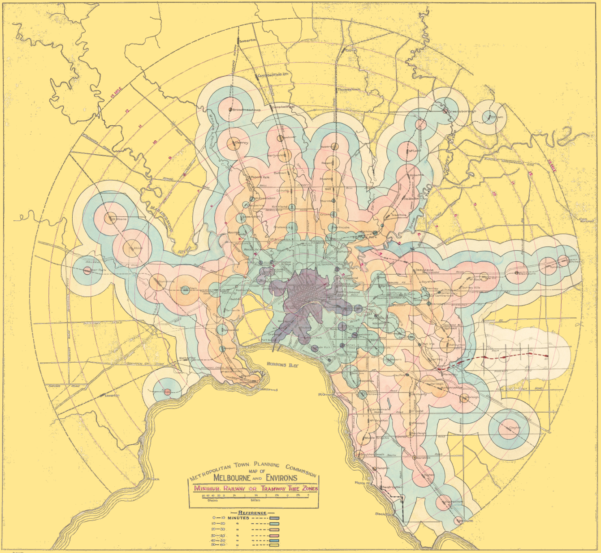

# Module overview {#sec-m4}

{width=60%}


::: {.modulo-meta}
**Workload:** 6 hours (3h synchronous + 3h asynchronous)\
**Dates:** 19/10 and 21/10 (synchronous); 22/10 (asynchronous)\
**Packages:** `osmdata`, `osmextract`, `sfnetworks`, `dodgr`, `accessibility`, `aopdata`, `usethis`, `quarto`, `geobr`, `censobr`, `sidrar`\
**Case study:** accessibility in Fortaleza
:::

## What you will be able to do by the end of the module

- Extract a study area's road network from OpenStreetMap and turn it into a
  topological network, ready for routing.
- Compute routes, distances and travel times for cars and freight on the road network.
- Compute and interpret accessibility-to-opportunities indicators, and understand what each
  measure (minimum time, cumulative, gravity, with competition) captures.
- Record the history of an analysis with Git and know what **cannot** go into a
  public repository.
- Put together a municipal diagnosis with the Census (`geobr`, `censobr`), SIDRA (`sidrar`) and
  coastal shipping, and produce the same report for several municipalities, in a loop.

## Outline

### Synchronous class (3h)

| Block | Content | Chapter |
|:--|:--|:--|
| 1 | OpenStreetMap data: road network and topological network | @sec-m4-osm |
| 2 | Car and freight routing with `dodgr` | @sec-m4-roteamento |
| 3 | Accessibility to opportunities: concept, measures and interpretation | @sec-m4-acessibilidade |
| 4 | Version control with Git and GitHub | @sec-m5-git |
| 5 | A municipal report: Paranaguá (Census, SIDRA and coastal shipping) | @sec-relatorio-paranagua |
| 6 | Parameterised reports: the same report for five municipalities | @sec-m5-parametrizados |

### Asynchronous content (3h)

| Block | Content | Chapter |
|:--|:--|:--|
| 6 | Exercises | @sec-m4-exercicios |

## Module packages

```{r}
#| eval: false
pacotes <- c("osmdata", "osmextract", "sfnetworks", "tidygraph", "dodgr",
             "accessibility", "aopdata", "h3jsr", "usethis", "gitcreds", "quarto",
             "geobr", "censobr", "sidrar")

faltando <- setdiff(pacotes, rownames(installed.packages()))
if (length(faltando) > 0) install.packages(faltando)
```

Git is installed outside R: see @sec-m5-git. The OSM and `dodgr` chapters use the
São Paulo–Santos network, which comes in this module's data package (and also in module 3's). The
accessibility analysis with `aopdata` runs without Java and without a manual *download*. The same data package
has the Fortaleza folder used by `r5r` in module 5 (@sec-m5).
