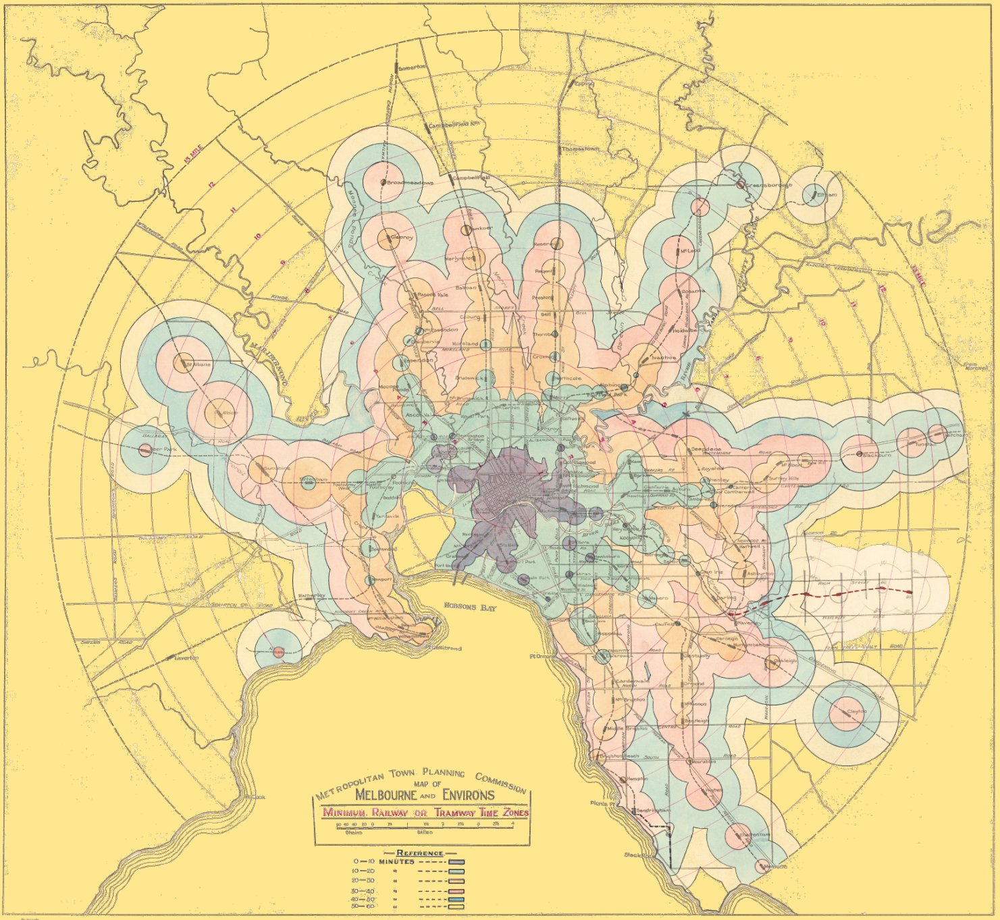

# Visão geral do módulo {#sec-m4}

{width=60%}


::: {.modulo-meta}
**Carga horária:** 6 horas (3h síncronas + 3h assíncronas)\
**Datas:** 19/10 e 21/10 (síncronas); 22/10 (assíncrono)\
**Pacotes:** `osmdata`, `osmextract`, `sfnetworks`, `dodgr`, `accessibility`, `aopdata`, `usethis`, `quarto`\
**Estudo de caso:** acessibilidade em Fortaleza
:::

## O que você vai conseguir fazer no fim do módulo

- Extrair do OpenStreetMap a malha viária de uma área de estudo e transformá-la numa rede
  topológica, pronta para roteamento.
- Calcular rotas, distâncias e tempos de viagem de automóvel e carga sobre a malha viária.
- Calcular e interpretar indicadores de acessibilidade a oportunidades, e entender o que cada
  medida (tempo mínimo, cumulativa, gravitacional, com concorrência) captura.
- Registrar o histórico de uma análise com Git e saber o que **não** pode ir para um
  repositório público.
- Gerar o mesmo relatório para vários municípios, trechos ou cenários, em um laço.

## Roteiro

### Aula síncrona (3h)

| Bloco | Conteúdo | Capítulo |
|:--|:--|:--|
| 1 | Dados do OpenStreetMap: malha viária e rede topológica | @sec-m4-osm |
| 2 | Roteamento de automóvel e carga com `dodgr` | @sec-m4-roteamento |
| 3 | Acessibilidade a oportunidades: conceito, medidas e interpretação | @sec-m4-acessibilidade |
| 4 | Controle de versão com Git e GitHub | @sec-m5-git |
| 5 | Relatórios parametrizados e automação | @sec-m5-parametrizados |

### Conteúdo assíncrono (3h)

| Bloco | Conteúdo | Capítulo |
|:--|:--|:--|
| 6 | Exercícios | @sec-m4-exercicios |

## Pacotes do módulo

```{r}
#| eval: false
pacotes <- c("osmdata", "osmextract", "sfnetworks", "tidygraph", "dodgr",
             "accessibility", "aopdata", "h3jsr", "usethis", "gitcreds", "quarto")

faltando <- setdiff(pacotes, rownames(installed.packages()))
if (length(faltando) > 0) install.packages(faltando)
```

O Git é instalado fora do R: veja @sec-m5-git. Os capítulos do OSM e do `dodgr` usam a malha
São Paulo–Santos, que vem no pacote de dados deste módulo (e também no do módulo 3). A
acessibilidade com `aopdata` roda sem Java e sem *download* manual. O mesmo pacote de dados
traz a pasta de Fortaleza usada pelo `r5r` no módulo 5 (@sec-m5).
