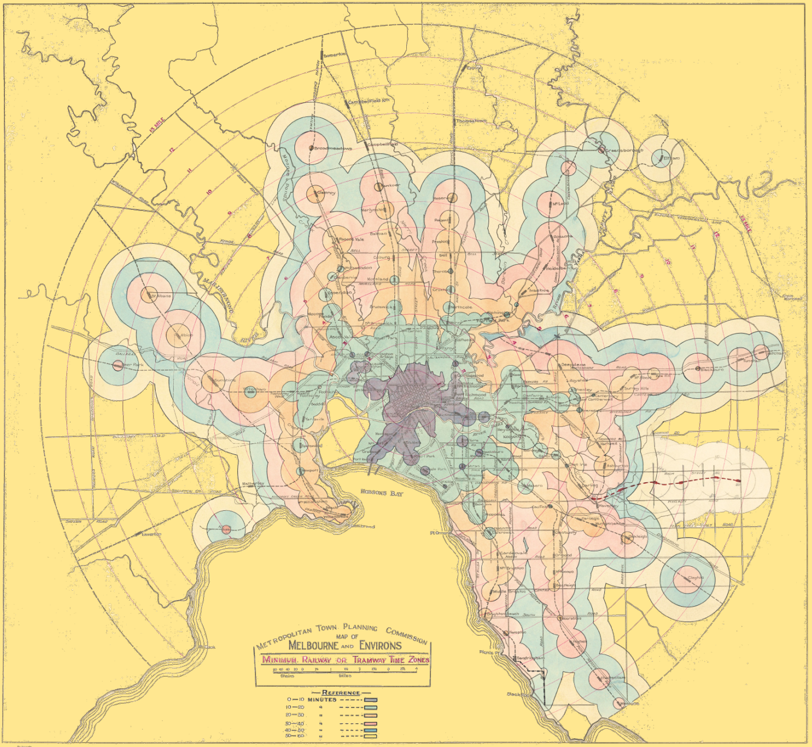

# Visão geral do módulo {#sec-m4}

{width=60%}


::: {.modulo-meta}
**Carga horária:** 6 horas (3h síncronas + 3h assíncronas)\
**Datas:** 19/10 e 21/10 (síncronas); 22/10 (assíncrono)\
**Pacotes:** `osmdata`, `osmextract`, `sfnetworks`, `dodgr`, `r5r`, `gtfstools`, `accessibility`, `aopdata`, `flownet`\
**Estudo de caso:** acessibilidade em Fortaleza
:::

## O que você vai conseguir fazer no fim do módulo

- Extrair do OpenStreetMap a malha viária de uma área de estudo e transformá-la numa rede
  topológica, pronta para roteamento.
- Calcular rotas, distâncias e tempos de viagem de automóvel e carga sobre a malha viária.
- Calcular e interpretar indicadores de acessibilidade a oportunidades, e entender o que cada
  medida (tempo mínimo, cumulativa, gravitacional, com concorrência) captura.
- Calcular matrizes de tempo de viagem multimodais e isócronas, e comparar cenários de rede de
  transporte público.

## Roteiro

### Aula síncrona (3h)

| Bloco | Conteúdo | Capítulo |
|:--|:--|:--|
| 1 | Dados do OpenStreetMap: malha viária e rede topológica | @sec-m4-osm |
| 2 | Roteamento de automóvel e carga com `dodgr` | @sec-m4-roteamento |
| 3 | Roteamento de transporte público com `r5r` e GTFS | @sec-m4-gtfs |
| 4 | Roteamento multimodal, cenários e isócronas com `r5r` | @sec-m4-r5r |
| 5 | Redes de fluxo e alocação (`flownet`, `stplanr`) | @sec-m4-r5r |
| 6 | Acessibilidade a oportunidades: conceito, medidas e interpretação | @sec-m4-acessibilidade |

### Conteúdo assíncrono (3h)

| Bloco | Conteúdo | Capítulo |
|:--|:--|:--|
| 7 | Exercícios | @sec-m4-exercicios |

## Pacotes do módulo

```{r}
#| eval: false
pacotes <- c("osmdata", "osmextract", "sfnetworks", "tidygraph", "dodgr",
             "r5r", "accessibility", "aopdata", "gtfstools", "h3jsr")

faltando <- setdiff(pacotes, rownames(installed.packages()))
if (length(faltando) > 0) install.packages(faltando)

# flownet ainda não está no CRAN
# remotes::install_github("SebKrantz/flownet")
```

::: {.callout-important}
## O `r5r` precisa de Java 21

O `r5r` é uma interface para o R5, o motor de roteamento da Conveyal, escrito em Java. Sem o
**JDK 21** instalado, o pacote carrega mas falha ao construir a rede. Verifique antes do
encontro:

```{r}
#| eval: false
# no terminal do sistema
# java -version    -> deve responder "21"

# dentro do R
rJava::.jinit()
rJava::.jcall("java/lang/System", "S", "getProperty", "java.version")
```

Se a instalação depender da TI do Ministério, peça o **JDK 21 (Temurin ou Oracle)** no mesmo
chamado do R e do Rtools.
:::

## Sobre os blocos que este site não executa

Os capítulos deste módulo são executados quando o site é construído, com uma exceção
declarada: os blocos que dependem do **`r5r`** exigem o JDK 21 e uma pasta com o `.pbf` do
OpenStreetMap e o GTFS da cidade: arquivos que não cabem no repositório. Esses blocos estão
marcados como não executados e trazem, no texto, o resultado esperado.

Para rodá-los na sua máquina, a pasta `dados/brutos/fortaleza/` já vem pronta no pacote de
dados do módulo, baixado pelo script de preparação (@sec-m4-osm). Para montá-la à mão, ou para
outra cidade:

```{r}
#| eval: false
dir.create("dados/brutos/fortaleza", recursive = TRUE, showWarnings = FALSE)

# 1. rede viária (OSM): não há extrato só do Ceará; vem o do Nordeste, com uns 450 MB
osmextract::oe_download(
  file_url = osmextract::oe_match("Ceará")$url,
  download_directory = "dados/brutos/fortaleza"
)

# 2. GTFS: baixe de https://dados.fortaleza.ce.gov.br (tag "gtfs")
#    e salve o .zip na mesma pasta, sem descompactar
```

O capítulo do `r5r` com Porto Alegre (@sec-m4-gtfs) não precisa dessa pasta: ele usa os dados
que vêm dentro do próprio `r5r`. Os capítulos do OSM e do `dodgr` usam a malha São
Paulo–Santos, que vem no pacote de dados deste módulo (e também no do módulo 3). A acessibilidade com `aopdata` roda sem Java e sem *download*
manual.
